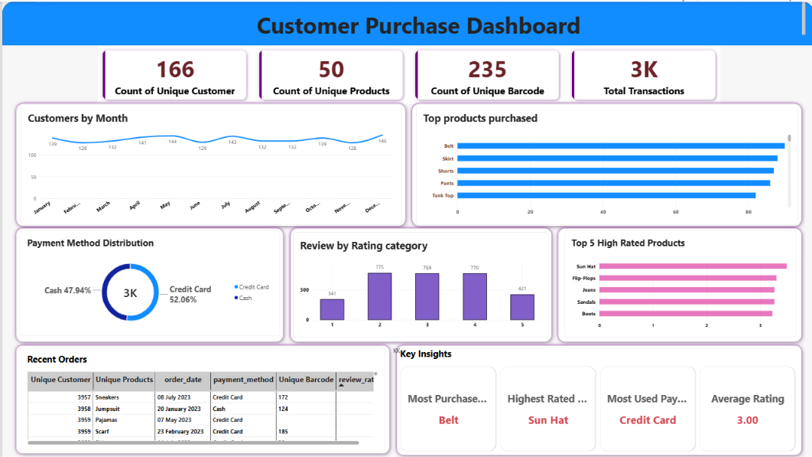

# 🛍️ Customer Purchase Dashboard

An end-to-end data analytics project using **PostgreSQL** and **Power BI** to clean, analyze, and visualize retail transaction trends. It turns raw fashion retail data into interactive business insights covering transaction volumes, customer ratings, product performance, and payment preferences.

---

## 📊 Dashboard Interface

Below is the dashboard built to help retail stakeholders track sales performance.

---

## 🛠️ Data Infrastructure & Schema

The project uses a structured relational table containing **3,430 rows** (transactions), configured in PostgreSQL with the following schema:

* **Customer Attributes:** customer_id (INT), age (INT), gender (VARCHAR), subscription_status (VARCHAR)
* **Transaction Details:** item_purchased (VARCHAR), category (VARCHAR), purchase_amount (INT), order_date (DATE), payment_method (VARCHAR), product_barcode
* **Logistics & Feedback:** garment_size (VARCHAR), color (VARCHAR), season (VARCHAR), review_rating (NUMERIC), Rating Category

---

## ⚙️ Data Pipeline Implementation

### 1. Database Management & ETL (PostgreSQL)
* **Table Initialization:** `01_create_table.sql` loads the raw transaction file into the local database (`staging_fashion_sales`).
* **Analytical Queries:** `02_product_sales_analysis.sql` groups data by item, color, and size to calculate aggregate metrics such as total units sold (`units_sold`) and total revenue.

### 2. Business Intelligence & Modeling (Power BI)
* **Data Integration:** Connected Power BI to the PostgreSQL staging table to import the transaction data.
* **DAX Measures:** Created custom measures, including **Total Transactions**, to count orders instead of summing customer IDs.
* **KPI Cards:**
  * **Unique Customers:** 166
  * **Unique Products:** 50
  * **Unique Barcodes:** 235
  * **Total Transactions:** 3,430
* **Average Rating:** 3.00

---

## 📈 Dashboard Visuals

* **Customers by Month:** Monthly view of customer activity across the year.
* **Top Products Purchased:** Transactions per item, showing which products sell most.
* **Payment Method Distribution:** Donut chart of Credit Card vs Cash usage.
* **Review by Rating Category:** Number of reviews at each rating level (1 to 5).
* **Top 5 High Rated Products:** Average rating by item.
* **Order Details:** Table of individual orders with item, date, payment method, barcode, and rating.
* **Key Insights:** Summary cards for most purchased item, highest rated item, most used payment method, and average rating.

---

## 🔍 Key Insights

* **Payment Preference:** Credit Card is the most used method at **52.06%**, followed by Cash at **47.94%**.
* **Top Item:** **Belt** is the most purchased item.
* **Highest Rated:** **Sun Hat** has the highest average rating, though the top-rated products score close to each other.
* **Overall Satisfaction:** Average rating across all reviews is **3.00**.

---

## ⚠️ Data Quality Notes

* Some records have missing values (for example, blank product barcodes or review ratings), so the rating chart does not cover every transaction.
* Future improvement: add SQL validation checks for nulls and duplicates, and a "No rating" category.

---

## 🚀 Possible Next Steps

* Add slicers for category, season, and payment method.
* Add a revenue view using `purchase_amount`.
* Add cohort or repeat-purchase analysis.

---

## 🧰 Tools Used

PostgreSQL • SQL • Microsoft Power BI • DAX
