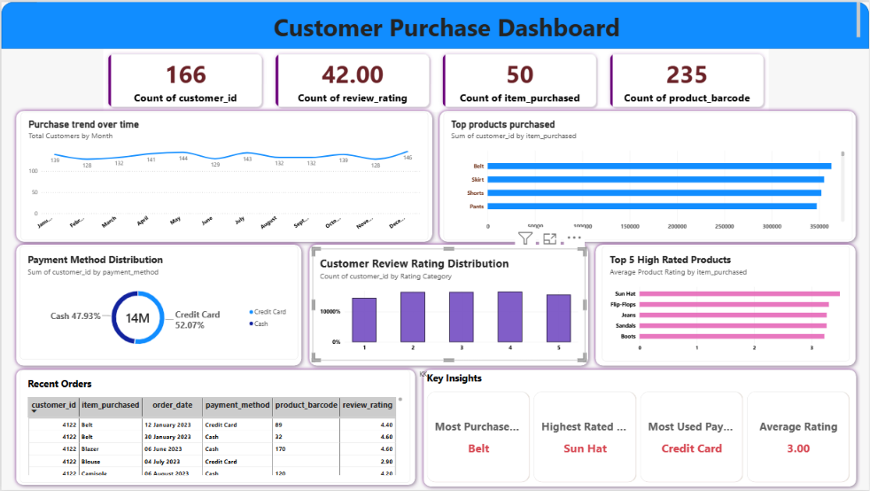

# 🛍️ Customer Purchase Dashboard

An end-to-end data analytics project using *PostgreSQL* and *Power BI* to clean, analyze, and visualize retail transactional trends. This project transforms raw fashion data into interactive business insights—tracking transaction volumes, ratings, product performance, and payment distributions.

---

## 📊 Dashboard Interface
Below is the executive-level interface built to help retail stakeholders track sales performance.

---

## 🛠️ Data Infrastructure & Schema
The project utilizes a structured relational table containing *3,430 rows* with the following explicit schema configured in PostgreSQL:

* *Customer Attributes:* customer_id (INT), age (INT), gender (VARCHAR), subscription_status (VARCHAR)
* *Transaction Profiles:* item_purchased (VARCHAR), category (VARCHAR), purchase_amount (INT), order_date (DATE), payment_method (VARCHAR), product_barcode
* *Logistics & Feedback:* garment_size (VARCHAR), color (VARCHAR), season (VARCHAR), review_rating (NUMERIC), Rating Category

---

## ⚙️ Data Pipeline Implementation

### 1. Database Management & ETL (PostgreSQL)
* *Table Initialization:* Developed 01_create_table.sql to ingest raw transaction files into the local database instance (staging_fashion_sales).
* *Analytical Queries:* Created processing scripts (02_product_sales_analysis.sql) to group data elements dynamically by item, color, and size to calculate aggregate metrics like total unit volumes (units_sold) and total revenue loops.

### 2. Business Intelligence & Modeling (Power BI)
* *Data Integration:* Connected Power BI to the PostgreSQL staging layer to import transactional data models cleanly.
* *DAX Analytics:* Developed custom calculation metrics to evaluate high-level business cards:
  * *Customer Count:* 166 unique customer records.
  * *Review Footprint:* 42.00 total review rating metrics evaluated.
  * *Inventory Diversity:* 50 distinct items purchased across 235 unique barcodes.
  * *Global Quality Average:* Standardized transaction rating calculated at 3.00.

---

## 📈 Key Insights Formatted on Dashboard
* *Payment Preference:* Credit Card usage represents the primary choice at *52.07%, closely followed by Cash methods at **47.93%*.
* *Item Performance:* Isolates high-volume performance spikes (such as *Belts* tracking as the most-purchased item and *Sun Hats* securing the highest ratings).
* *Rating Distributions:* Visualizes customer review scores broken down across discrete category groups to evaluate overall satisfaction trends.
